# forecasting-using-arima-catboost

[README.md](https://github.com/user-attachments/files/34868549/README.md)
# Forecasting Total Affected Humans from Natural and Technological Hazards in the Philippines Using a Hybrid ARIMA–CatBoost Model


---

## Overview

The Philippines lies along the Pacific Ring of Fire and within the typhoon belt, making it one of the most disaster-prone countries in the world. One key indicator of disaster impact is **total affected humans**: people who are directly impacted, injured, displaced, or evacuated.

Most existing studies focus on disaster occurrence counts or economic damages. Few have built forecasting models for human impact, particularly in the Philippine context. This project fills that gap by developing a **hybrid ARIMA–CatBoost model**:

- **ARIMA** models the *linear* component of the series.
- **CatBoost** (gradient boosting) learns the *nonlinear* patterns left in the ARIMA residuals.
- The **final forecast** = ARIMA forecast + (damped) CatBoost residual correction.

The hybrid is compared against standalone ARIMA and standalone CatBoost models.

---

## Objectives

1. Describe the historical behavior of total affected humans from 1963 to 2024.
2. Identify and estimate the most appropriate ARIMA model.
3. Develop a CatBoost model on ARIMA residuals to capture nonlinear patterns.
4. Construct a hybrid forecasting model that integrates ARIMA and CatBoost predictions.
5. Compare ARIMA, CatBoost, and Hybrid using MAE, RMSE, and MAPE (plus SMAPE, R², and Theil's U).
6. Generate five-year-ahead forecasts (2025–2029) with the best-performing model.

---

## Data

| Item | Description |
|---|---|
| **Source** | [EM-DAT: The International Disaster Database](https://www.emdat.be/) (CRED & UNDRR) |
| **Variable** | Total affected humans from natural and technological hazards |
| **Coverage** | Philippines, annual, **1963–2024** (62 observations) |
| **Approach** | Univariate (no external explanatory variables) |
| **Transformation** | `log(1 + affected)` to stabilize variance and reduce the effect of extreme values |
| **Train/Test split** | 80% training / 20% testing (chronological) |

---

## Methodology

### Workflow

```
EM-DAT data (1963–2024)
        │
        ▼
 Log transform + 80/20 split
        │
        ├──────────────► Standalone CatBoost (lag features) ──────────┐
        ▼                                                              │
 ARIMA(5,1,1) on training set                                          │
        │                                                              │
        ├── ARIMA forecast ───────────────┐                            │
        ▼                                 │                            │
 ARIMA residuals                          │                            │
        │                                 ▼                            ▼
 CatBoost on residuals ──► damped correction (×0.3) ──► HYBRID    Model comparison
                                                                  (MAE, RMSE, MAPE, ...)
```

### 1. Data Preparation

The data was sorted by year, non-numeric characters were removed, and a log transformation was applied.

```r
affecteddata <- read.csv("TSA ARIMA Catboost Data.csv")
affecteddata <- affecteddata[order(affecteddata$Year), ]

affected_raw <- as.numeric(gsub("[^0-9.]", "", affecteddata$affected))
affected_log <- log1p(affected_raw)

start_year  <- min(affecteddata$Year)
ts_raw      <- ts(affected_raw, start = start_year, frequency = 1)
ts_affected <- ts(affected_log, start = start_year, frequency = 1)

# 80/20 train-test split
n_total    <- length(ts_affected)
train_size <- floor(0.80 * n_total)
train_ts   <- window(ts_affected, end   = time(ts_affected)[train_size])
test_ts    <- window(ts_affected, start = time(ts_affected)[train_size + 1])
```

### 2. ARIMA Modeling

**Stationarity.** ADF and KPSS tests were applied to the training series, and `ndiffs()` determined the differencing order.

```r
adf.test(train_ts)
kpss.test(train_ts)
d <- ndiffs(train_ts)
train_diff <- diff(train_ts, differences = d)
```

**Identification and estimation.** ACF/PACF plots of the differenced series guided the choice of candidates. Five ARIMA models were estimated via maximum likelihood and compared using AIC and residual diagnostics.

```r
model_1 <- Arima(train_ts, order = c(1, 1, 6), include.mean = TRUE, method = "ML")
model_2 <- Arima(train_ts, order = c(1, 1, 7), include.mean = TRUE, method = "ML")
model_3 <- Arima(train_ts, order = c(5, 1, 1), include.mean = TRUE, method = "ML")
model_4 <- Arima(train_ts, order = c(1, 1, 2), include.mean = TRUE, method = "ML")
model_5 <- Arima(train_ts, order = c(1, 1, 8), include.mean = TRUE, method = "ML")

arima_fit <- model_3   # selected model
checkresiduals(arima_fit)
```

**Forecasting.** The fitted model forecasts the test set. It was then refit on the full series for the 2025–2029 forecast.

```r
test_forecast   <- forecast(arima_fit, h = length(test_ts))
arima_pred_test <- as.numeric(test_forecast$mean)

final_fit  <- Arima(ts_affected, order = c(5, 1, 1), include.mean = TRUE)
future_5yr <- forecast(final_fit, h = 5)
```

### 3. Standalone CatBoost

**Features:** five lagged values (`lag1`–`lag5`) and a time index, aligned with the ARIMA train/test split.

```r
create_catboost_direct_features <- function(series, lags = 5) {
  n <- length(series)
  X <- matrix(NA, nrow = n - lags, ncol = lags + 1)
  y <- numeric(n - lags)
  for (i in (lags + 1):n) {
    idx <- i - lags
    X[idx, 1] <- i
    X[idx, 2:(lags + 1)] <- series[(i - 1):(i - lags)]
    y[idx] <- series[i]
  }
  colnames(X) <- c("time_idx", paste0("lag", 1:lags))
  list(X = X, y = y)
}
```

**Hyperparameters:**

| Parameter | Value |
|---|---|
| Iterations | 150 |
| Learning rate | 0.05 |
| Depth | 4 |
| Loss function | RMSE |
| Random seed | 1234 |

### 4. Hybrid ARIMA–CatBoost

1. **Extract residuals** from the fitted ARIMA model on the training set.
2. **Engineer residual features:** five lagged residuals, their rolling mean, and a time index.
3. **Train CatBoost on the residuals** (150 iterations, learning rate 0.05, **depth 3**, RMSE).
4. **Forecast recursively.** At each test step, CatBoost predicts the next residual. The prediction is scaled by a **damping factor of 0.3** to prevent overcorrection, then added to the ARIMA forecast.

```r
arima_fitted_train    <- fitted(arima_fit)
arima_residuals_train <- as.numeric(train_ts - arima_fitted_train)

recent_residuals <- tail(arima_residuals_train, 5)
hybrid_pred_test <- numeric(length(test_ts))
DAMPING_FACTOR   <- 0.3

for (i in 1:length(test_ts)) {
  features <- matrix(c(length(train_ts) + i,
                       rev(recent_residuals),
                       mean(recent_residuals)), nrow = 1)
  colnames(features) <- colnames(X_resid_train)

  pool       <- catboost.load_pool(features)
  resid_pred <- catboost.predict(catboost_resid_model, pool) * DAMPING_FACTOR

  hybrid_pred_test[i] <- arima_pred_test[i] + resid_pred

  # update residual memory using actual
  actual_resid     <- as.numeric(test_ts[i] - arima_pred_test[i])
  recent_residuals <- c(recent_residuals[-1], actual_resid)
}
```

### 5. Model Evaluation

Models were evaluated on the held-out test set using **MAE, RMSE, MAPE, SMAPE, R², and Theil's U** (against a naive random-walk benchmark). The model with the lowest **RMSE** was considered best.

---

## Results

### Exploratory Analysis

The raw series shows a strong upward trend with rising level and variance, especially after 2000. This is a non-stationary series driven by extreme high-impact years.

<p align="center">
  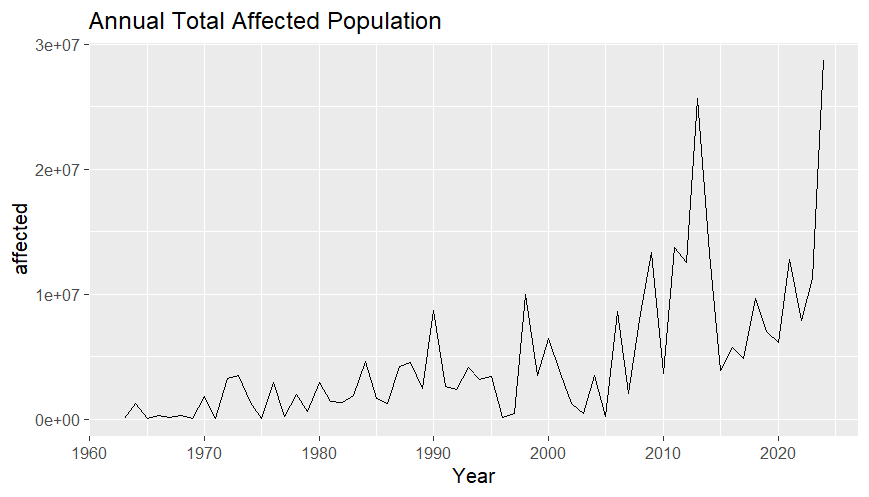<br>
  <em>Figure 1. Annual Total Affected Population (1963–2024)</em>
</p>

The log transformation stabilizes the variance and dampens extreme spikes while preserving the long-term upward trend.

<p align="center">
  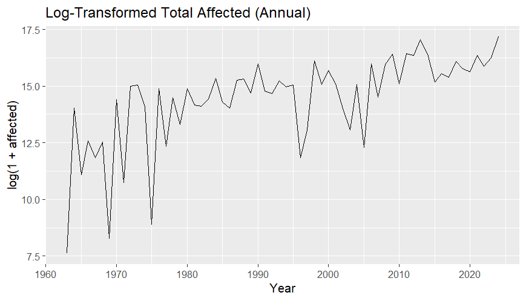<br>
  <em>Figure 2. Log-Transformed Annual Total Affected Population (1963–2024)</em>
</p>

### Stationarity Tests (Training Set)

| Test | Statistic | p-value | Conclusion |
|---|---|---|---|
| Augmented Dickey-Fuller | −2.9895 (lag order 3) | 0.1782 | Fail to reject non-stationarity |
| KPSS (level) | 0.9337 (truncation lag 3) | 0.01 | Reject stationarity |

Both tests indicate non-stationarity, so **d = 1** was adopted.

### ACF / PACF of the First-Differenced Series

Both plots show a strong negative spike at lag 1, with the remaining lags mostly within the confidence bounds. This suggests short-term, low-order dependence.

<p align="center">
  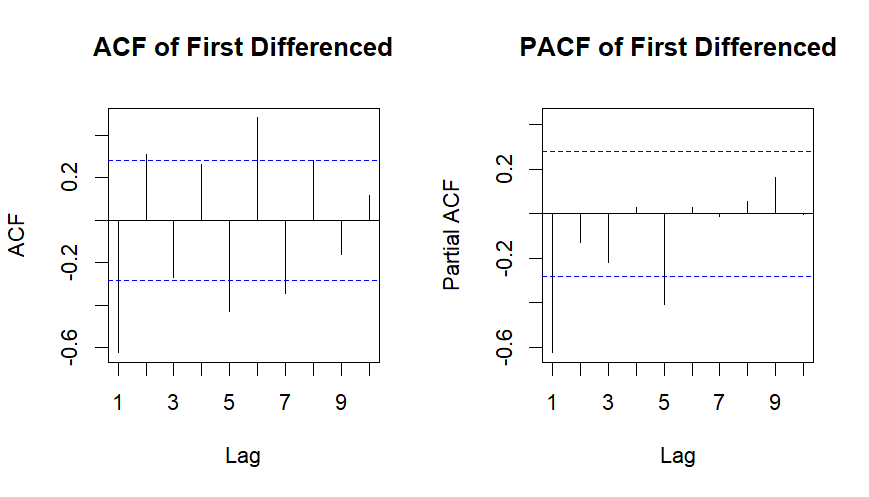<br>
  <em>Figure 3. ACF and PACF of the First-Differenced Series</em>
</p>

### ARIMA Model Selection

| Model | Specification | AIC | Ljung–Box p-value |
|---|---|---|---|
| Model 1 | ARIMA(1,1,6) | **186.88** | 0.4066 |
| Model 2 | ARIMA(1,1,7) | 188.69 | 0.3999 |
| **Model 3** | **ARIMA(5,1,1)** ✅ | 189.93 | 0.2632 |
| Model 4 | ARIMA(1,1,2) | 190.28 | 0.1373 |
| Model 5 | ARIMA(1,1,8) | 190.65 | 0.3460 |

ARIMA(1,1,6) had the lowest AIC, but its MA roots were close to the unit circle (near non-invertibility). **ARIMA(5,1,1)** was selected for its stable and invertible parameters, clean residual diagnostics, and competitive fit.

### Final ARIMA(5,1,1) Coefficients

| Parameter | Estimate | Std. Error |
|---|---|---|
| ar1 | −1.0482 | 0.3765 |
| ar2 | −0.6989 | 0.3563 |
| ar3 | −0.5441 | 0.2329 |
| ar4 | −0.4714 | 0.1970 |
| ar5 | −0.4971 | 0.1295 |
| ma1 | 0.2148 | 0.4651 |

Fit statistics: log-likelihood = −87.96 · AIC = 189.93 · AICc = 192.73 · BIC = 203.03

**Training-set accuracy (log scale):** RMSE = 1.457 · MAE = 1.077 · MAPE = 7.97% · ACF1 = 0.013

### Residual Diagnostics

The residuals fluctuate around zero with no visible trend. Ljung–Box gives Q* = 5.244, p = 0.2632, so the residuals behave like white noise.

<p align="center">
  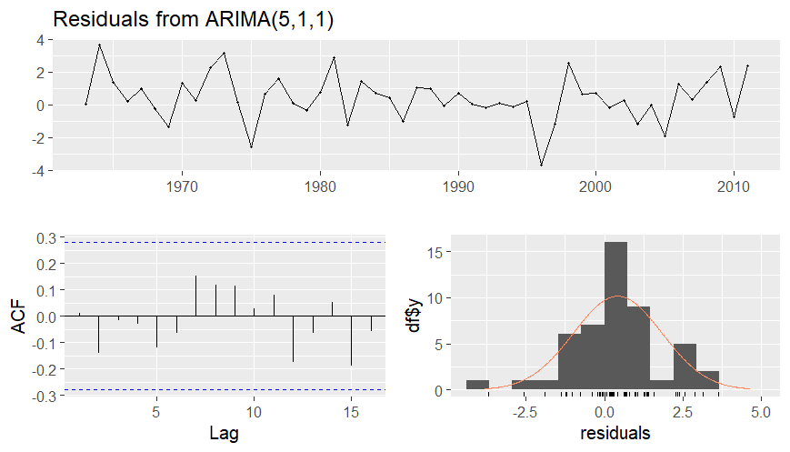<br>
  <em>Figure 4. Residual Diagnostics for the ARIMA(5,1,1) Model</em>
</p>

All inverse AR and MA roots lie inside the unit circle, so the model is stationary and invertible.

<p align="center">
  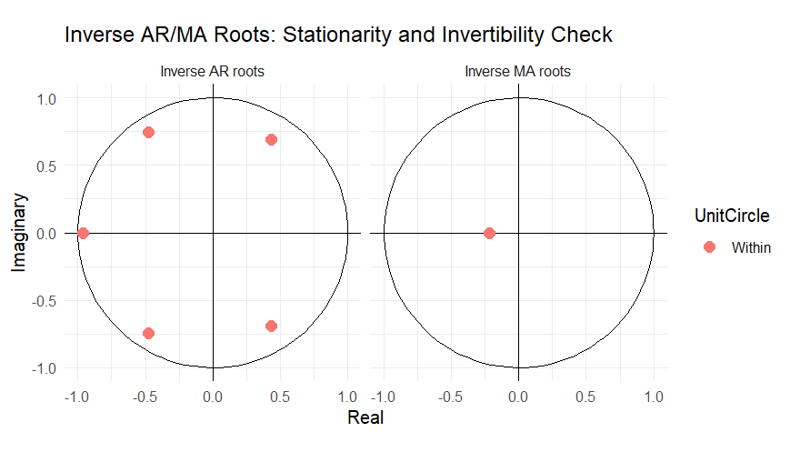<br>
  <em>Figure 5. Inverse AR and MA Roots: Stationarity and Invertibility Diagnostics</em>
</p>

### ARIMA Fit and Test Forecast

<p align="center">
  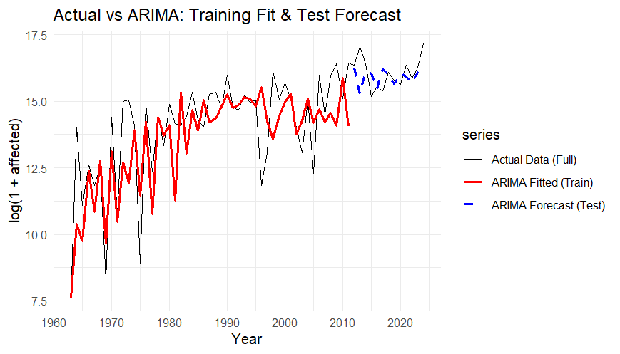<br>
  <em>Figure 6. Actual vs. ARIMA(5,1,1): Training Fit and Test Forecast</em>
</p>

### ARIMA 5-Year Projection

<p align="center">
  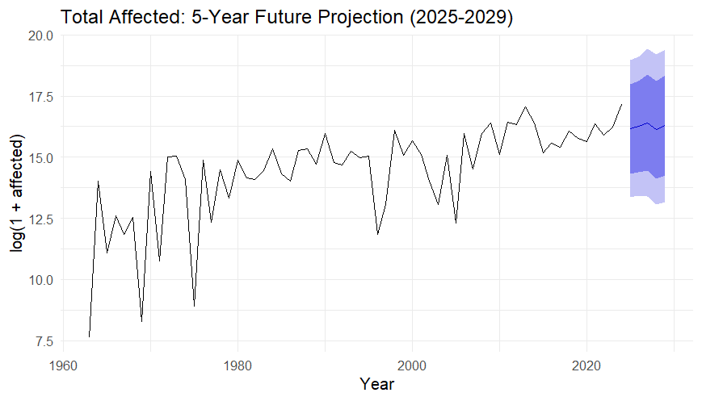<br>
  <em>Figure 7. Projected Trends in Total Affected Population, 2025–2029 (ARIMA)</em>
</p>

### CatBoost Training Performance

| Iteration | Standalone CatBoost (learn RMSE) | Hybrid residual CatBoost (learn RMSE) |
|---|---|---|
| 0 | 1.7062 | 1.3679 |
| 50 | 1.0604 | 1.0646 |
| 100 | 0.7529 | 0.8287 |
| 149 | 0.5422 | 0.6441 |

The residual model ends with a higher training error than the standalone model. This is expected because the residual series carries less structured signal.

### Test-Set Forecast Comparison

ARIMA tracks the overall pattern but smooths sharp peaks. Standalone CatBoost produces flat, low-amplitude predictions that underestimate high values. The Hybrid tracks the actual series most closely, particularly around peaks and recoveries.

<p align="center">
  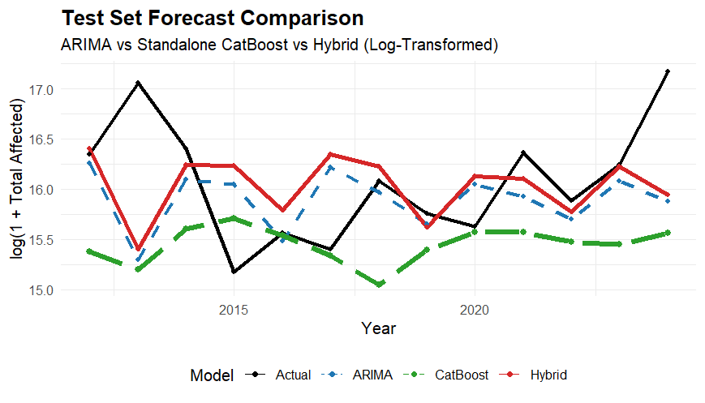<br>
  <em>Figure 8. Test Set Forecast Comparison of ARIMA, CatBoost, and Hybrid Models (Log-Transformed)</em>
</p>

<p align="center">
  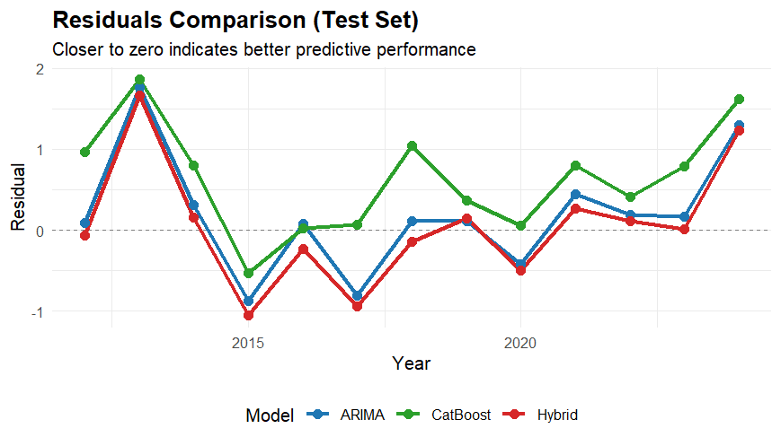<br>
  <em>Figure 9. Test Set Residuals Comparison for ARIMA, CatBoost, and Hybrid Models</em>
</p>

### Error Metrics (Test Set)

| Model | MAE | RMSE | MAPE (%) | SMAPE (%) | R² | Theil's U |
|---|---|---|---|---|---|---|
| ARIMA | 0.5121 | 0.7220 | 3.1398 | 3.1862 | −0.5673 | 1.1666 |
| CatBoost | 0.7176 | 0.9029 | 4.3608 | 4.5037 | −1.4495 | 1.4584 |
| **Hybrid** 🏆 | **0.5007** | **0.7192** | **3.0889** | **3.1125** | **−0.5542** | **1.1617** |

The **Hybrid ARIMA–CatBoost** model achieves the best score on every metric, though its margin over ARIMA is modest. Standalone CatBoost performs the weakest.

---

## Five-Year Forecasts (2025–2029)

Both models project a continuation of recent high levels with no abrupt structural break. ARIMA gives a conservative baseline, while the Hybrid gives a higher, more responsive path. Together they can be read as a plausible range of outcomes.

<p align="center">
  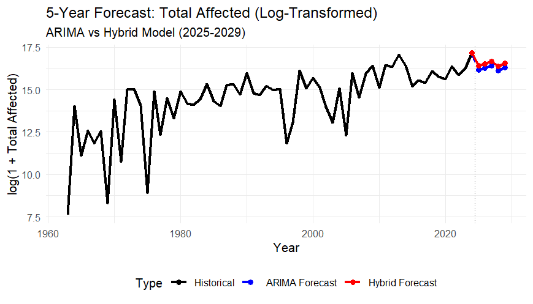<br>
  <em>Figure 10. Five-Year Ahead Forecast Using ARIMA and Hybrid Models (Log-Transformed, 2025–2029)</em>
</p>

<p align="center">
  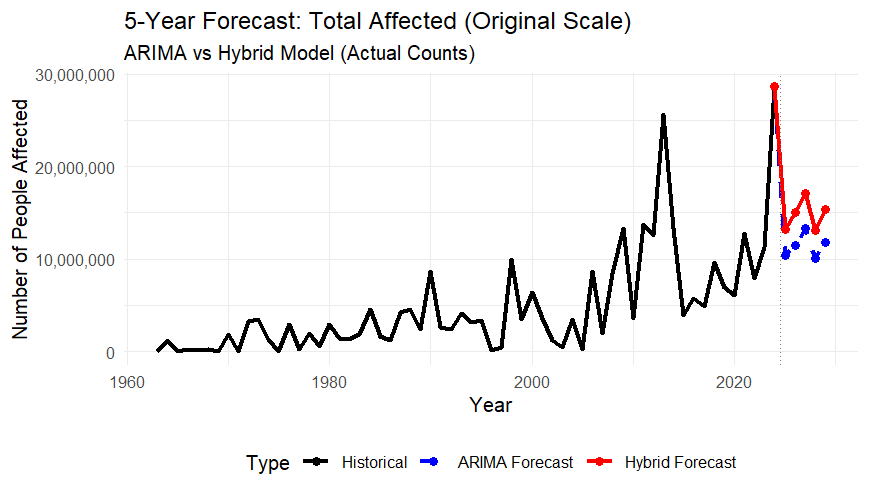<br>
  <em>Figure 11. Five-Year Forecast, Original Scale (Actual Counts): ARIMA vs Hybrid</em>
</p>

| Year | ARIMA (affected) | Hybrid (affected) |
|---|---|---|
| 2025 | 10,424,165 | 13,207,306 |
| 2026 | 11,500,220 | 15,016,947 |
| 2027 | 13,316,780 | 17,077,187 |
| 2028 | 10,126,542 | 13,112,860 |
| 2029 | 11,857,043 | 15,368,363 |

---

## Key Findings

- The series is **non-stationary and shock-driven**, with rising level and variance after the 1980s and especially after 2000.
- **ARIMA(5,1,1)** was chosen as the best linear model. It is stable, invertible, and its residuals are white noise.
- **CatBoost alone** is insufficient for this series. It underpredicts and has the highest errors.
- The **Hybrid ARIMA–CatBoost** model achieved the lowest MAE, RMSE, MAPE, and SMAPE, giving incremental gains over ARIMA.
- Forecasts for **2025–2029** point to persistently high numbers of affected people (about 10–13 million under ARIMA and 13–17 million under the Hybrid).

---

## Limitations

- **Small improvement over ARIMA.** The Hybrid's gains are modest (RMSE 0.7192 vs 0.7220).
- **Negative R² and Theil's U > 1** for all models. None beat the mean-based or naive random-walk benchmarks on the test set, reflecting the volatility of the series.
- **Univariate only.** No external predictors (e.g., hazard type, ENSO indicators, population exposure) were used.
- **Small sample.** With 62 annual observations, the test set is only about 13 years.
- **Hybrid design choices.** The damping factor (0.3) and CatBoost hyperparameters were fixed rather than tuned. During test-set forecasting, the residual features are updated with actual test residuals.
- **Hybrid 5-year forecasts are scenario-like.** The Hybrid path is best interpreted as an upper-bound scenario next to the ARIMA baseline.

---

## Tools and Packages

All analysis was done in **R**.

| Package | Purpose |
|---|---|
| `forecast` | ARIMA modeling, forecasting, diagnostics |
| `tseries` | ADF and KPSS stationarity tests |
| `catboost` | Gradient boosting models |
| `ggplot2` | Visualization |
| `seastests` | Optional seasonality checks |

---

## Repository Structure

```
.
├── README.md
├── images/                    # Figures used in this README
│   ├── fig01.png ... fig11.png
├── data/
│   └── TSA ARIMA Catboost Data.csv   # EM-DAT export (add your file here)
├── scripts/
│   └── hybrid_arima_catboost.R       # Main analysis script (add your file here)
└── docs/
    └── TSA_Seatworks.pdf             # Full paper (optional)
```

---

## References

- Almuiña, A. (2024). *boostime: Hybrid forecasting using ARIMA and machine learning models* (R package). https://github.com/AlbertoAlmuinha/boostime
- Box, G. E. P., Jenkins, G. M., Reinsel, G. C., & Ljung, G. M. (2015). *Time Series Analysis: Forecasting and Control* (5th ed.). Wiley.
- CRED & UNDRR. (2024). *EM-DAT: The International Disaster Database*. Université catholique de Louvain. https://www.emdat.be/
- Dorogush, A. V., Ershov, V., & Gulin, A. (2018). CatBoost: Gradient boosting with categorical features support. *arXiv*. https://doi.org/10.48550/arXiv.1810.11363
- Hyndman, R. J., & Khandakar, Y. (2008). Automatic time series forecasting: The forecast package for R. *Journal of Statistical Software, 27*(3), 1–22. https://doi.org/10.18637/jss.v027.i03
- Prokhorenkova, L., Gusev, G., Vorobev, A., Dorogush, A. V., & Gulin, A. (2018). CatBoost: Unbiased boosting with categorical features. *arXiv*. https://doi.org/10.48550/arXiv.1706.09516
